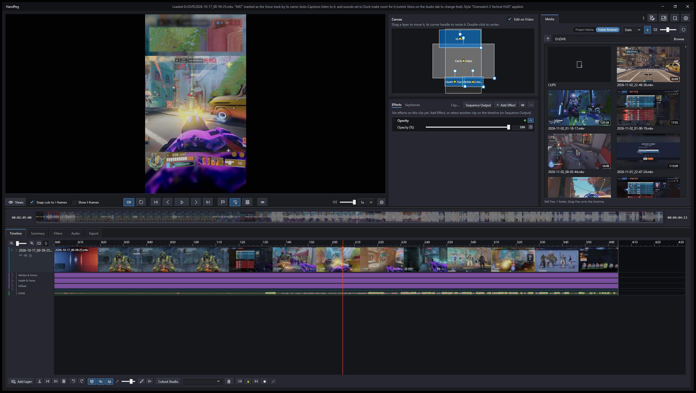
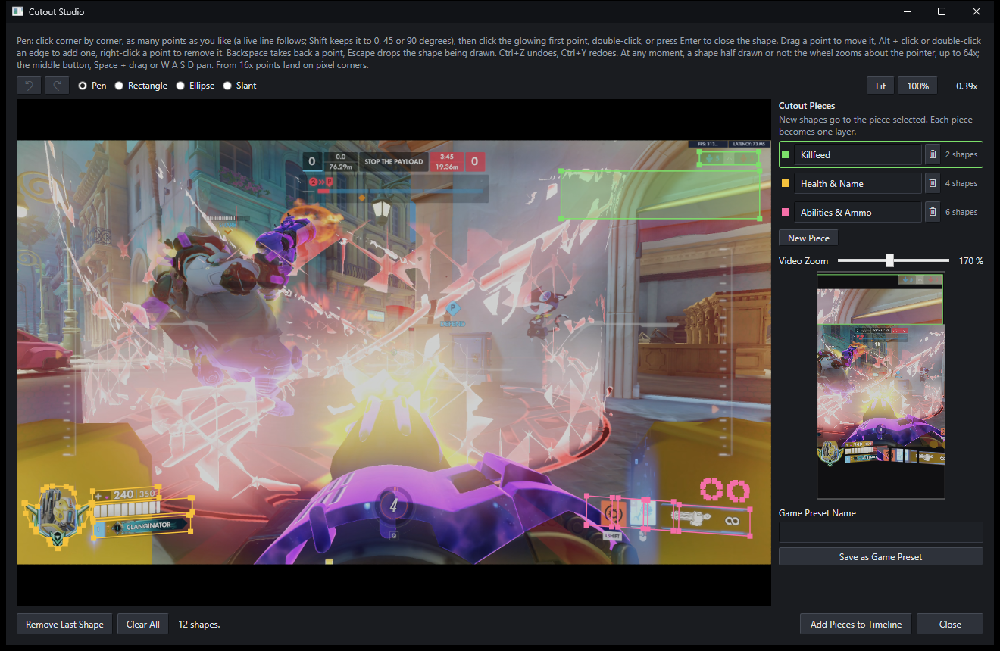
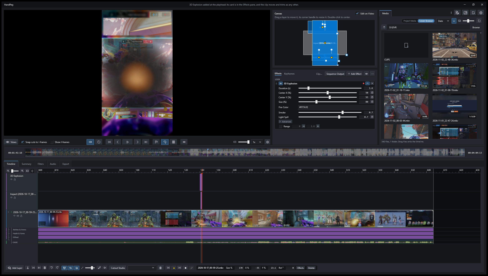
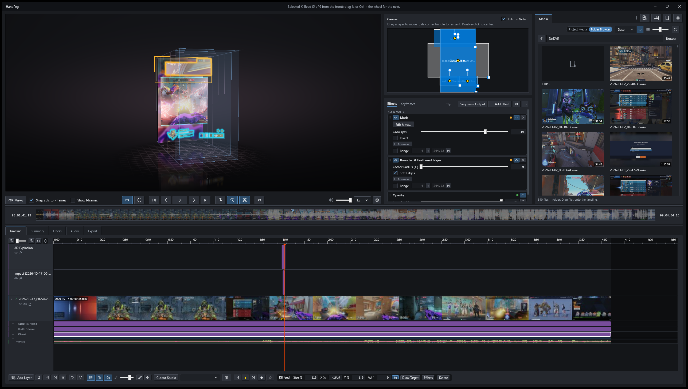
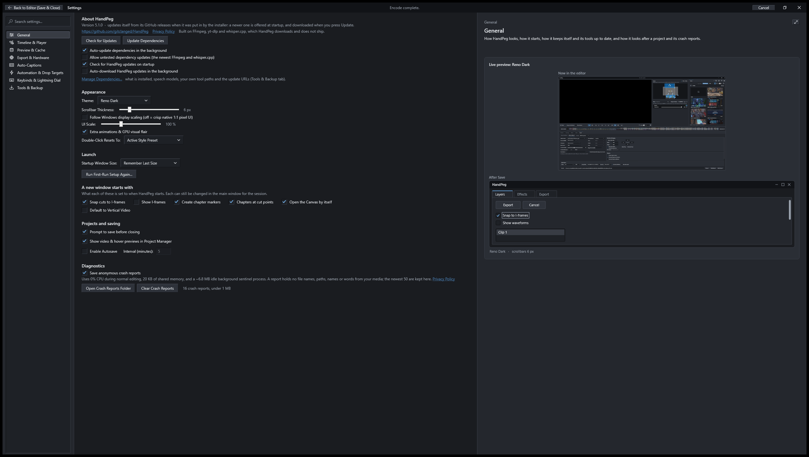

# HandPeg

[](https://github.com/gitclanged/HandPeg/releases/latest)
[](#getting-started)
[](https://dotnet.microsoft.com/download/dotnet/8.0)
[](LICENSE)

HandPeg is a featherweight, hardware-accelerated video editor for Windows, built for getting from a raw gameplay
recording, stream VOD or screen capture to a finished highlight, short or upload as fast as possible.

Since v5.0 HandPeg has its own GPU engine: a native Direct3D 11 compositor with every effect written in HLSL, the video
decoded straight into graphics memory, running in a process of its own so a driver hiccup restarts it in a blink instead
of taking the editor down. It plays, scrubs and exports the edit frame-exact, with a WASAPI mixer as the master clock;
FFmpeg encodes, and stays the export's fallback. The window paints its first, final frame in under half a second, and
HandPeg idles well under 200 MB of memory.











**New in v5.1.0:** built-in Game Presets for Overwatch 2, Marvel Rivals, Valorant, CS2, Apex Legends and The Finals; the
Cutout Studio to draw your own game's HUD pieces down to the pixel and save them as a preset; presets that belong to a
clip, so every clip can have its own; game-engine shaders (Motion Blur with a real shutter, Halation, Neon Rim, Frosted
Glass, Shockwave, Anamorphic Lens and 3D VFX drop-ins) and a 3D Fly-In + Shockwave macro; the 3D view's Studio Stage;
one lane per sound track of a recording; crossfade boxes, per-track heights and a seven-group right-click menu; captions
you can place anywhere in the layer stack; drawn masks kept as pure outlines; native 1:1 pixel UI with its own scale; and
6 MB portable zips for x64 and ARM64 with a one-click, no-admin .NET helper for PCs that have none.

## What it does
- **One multi-track timeline:** video, image, text and audio layers with a live preview of the finished picture and
  sound. Trim any clip from either edge (Shift for frame-by-frame without snapping, Ctrl to ripple), crossfade
  neighbouring clips on one track, split or trim at an exact timecode from a clip's menu. Splitting a keyframed clip
  keeps both halves' motion exactly, and cuts are just split points: what is on the timeline is what renders.
- **Game Presets in one drop:** drop a gameplay video on a game's preset and get a tall frame, the HUD pieces cut out with
  their own masks, and a blurred background, all made from your video. Six games come built in; draw your own in the
  Cutout Studio (polygon pen, rectangle, ellipse and slant, zoom to 64x with a pixel grid) and save it as a preset. A
  preset belongs to a clip: put a different one on every clip, and clips dropped onto a preset's track take it.
- **Game-engine shaders:** Motion Blur with a real shutter, Film Halation & Glow, Neon Rim Light and Frosted Glass that
  follow a clip's shape, Impact Shockwave, Anamorphic Lens, and 3D VFX (explosions, sparks, anime lines, shields, sabers)
  that drop in at the playhead and light what is under them, all drawn by HLSL on your graphics card.
- **A GPU engine that keeps up:** the preview is composited on your graphics card from frames decoded in its memory, with
  Instant Seek (a frame cache under Windows' own memory budget, pre-decoding round the playhead, under the pointer, ahead
  of a scrub and at every cut coming up), so long recordings with rapid cuts play and scrub at once, with the sound in
  step with the picture to the millisecond. Exports run on the same engine, frame-exact, and FFmpeg encodes them.
- **The 3D Exploded View:** fan the layer stack out in depth to see and pick what sits where; orbit, move, resize and
  restack layers in 3D, and the Timeline follows.
- **Project bundles:** save a project with all its media as one .hpb file (stored, not recompressed) and open it on
  another PC.
- **Effect stacks in zones:** each clip's effects are cards, applied in order: key, mask (with a Mask Offset to nudge a
  HUD mask), color, blur, blend modes, adjustment layers and a Sequence Output stack, each animatable. Copy a stack and
  paste it whole, onto a whole track, or just the cards you pick.
- **Edit right on the video:** select, drag, resize and turn layers on the preview; 3D drop shadows.
- **Keyframe lanes and curves:** a lane per property, easings from Hold to Bounce (each drawn as its own curve icon) and
  Custom Bezier, an anchor point, and multi-select to move, ease, copy or delete keys together.
- **Fades and transitions** at a clip's corners: dissolves, wipes, slides, zooms and blur dissolves, each with its icon.
- **Easy Social Export:** one-click cards for vertical shorts, a YouTube master, chat-size targets (under 10, 25 or 50 MB),
  a social feed HD file and a lossless archive, with every setting still open in Advanced Export. Copy YouTube chapter
  timestamps straight from your markers, with SponsorBlock segments cut out or kept as chapters.
- **Media browser:** posters for a whole folder in moments (one frame each first, the hover-scrub strips after), smooth
  middle-click scrolling, and drag-and-drop onto the timeline.
- **Dockable layouts:** every part of the window is a pane you can dock, tab together or move to a side window. Four
  built-in layouts (Standard Editing, Color & Effects, Assembly & Media, Vertical & Shorts Studio) and three of your
  own, previewed live from the Layout button; a right-click on any pane's tab holds that pane's settings.
- **Five themes:** Windows System, OLED Black, Leonardo, Reno and Reno Dark. Every icon and curve is drawn from
  geometry: no bitmap UI assets.
- **Auto-captions** with whisper.cpp; **downloads** with yt-dlp, signing in through your browser's cookies when a site
  asks for it.
- **Hardware encoders** (NVENC, AMF, Quick Sync) tested on your PC during setup, with a software fallback.
- **Crash diagnostics without personal data:** a crash writes a small plain-text report to your PC with no file names,
  paths, user names or words from your media. Nothing is sent anywhere.

## Getting started
Download the installer (`HandPeg-win-Setup.exe`) or a portable zip from the
[Releases page](https://github.com/gitclanged/HandPeg/releases). The first-run wizard lets you pick a theme and a
starting workspace, downloads the tools HandPeg uses (FFmpeg, yt-dlp and, if you want captions, whisper.cpp), pinned to
builds tested with this version, and measures your graphics cards and their hardware encoders.

- **Installer:** Windows 10 or 11 (x64) with the .NET 8 Desktop Runtime. HandPeg updates itself from the Releases page.
- **Portable zips (about 6 MB):** `HandPeg-<version>-win-x64-Portable.zip` and, for Windows on ARM,
  `HandPeg-<version>-win-arm64-Portable.zip` (native ARM64, with the ARM64 builds of its engines). Unzip and run. On a PC
  without .NET 8 (a work PC where you cannot install anything), double-click `Download Portable .NET (No Admin).cmd` once:
  it downloads Microsoft's .NET 8 runtime for that build, checks Microsoft's published SHA-512 hashes, and unpacks it into
  the folder, with no admin rights and nothing installed; `HandPeg.exe` then starts directly, from the folder alone.
  Everything a portable copy writes (settings, projects, caches, downloaded tools) stays in the `portable` folder beside
  `HandPeg.exe`, so the whole folder can live on a USB drive. Update it by unzipping a newer one and moving the `portable`
  folder (and, if you ran the helper, the `shared` folder and `hostfxr.dll`) across.

## Building from source
```
dotnet build HandPegApp.csproj
pwsh -NoProfile -File tools\GoldenTests.ps1
```
The repository:

| Path | What is there |
|---|---|
| `src/` | The program: `Program.cs`, `App.xaml`, `MainWindow` and its partials |
| `src/Controls/` | Drawn controls: timeline tracks, keyframe lanes, gizmos, the video surface, button chrome |
| `src/Dialogs/` | Windows and dialogs: first run, settings, Project Manager, layer and caption tools |
| `src/Docking/` | The dock manager, panes, tabs and title rows |
| `src/Views/`, `src/ViewModels/` | The Media, Effects and subtitle panes; the main view model and its partials |
| `src/Compositor/` | The GPU engine's worker process: Direct3D 11 and Media Foundation by hand, the HLSL shaders, the frame cache |
| `src/Services/` | The GPU preview engine and scene plans, the WASAPI mixer, the filter graph compiler, FFmpeg runner, probes, caches, background work, themes |
| `src/Models/` | Layers, effects and their registry, easing curves, transitions, presets, sequences |
| `tools/` | Golden tests, the A/V sync harness, the startup benchmark, the code index |

## License
MIT: see [LICENSE](LICENSE).
