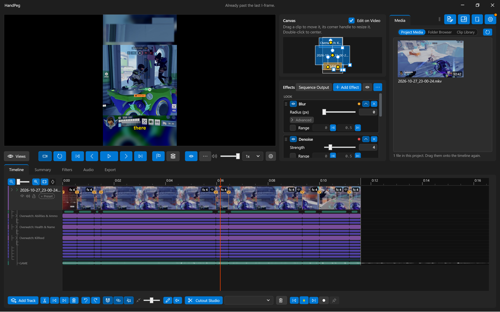
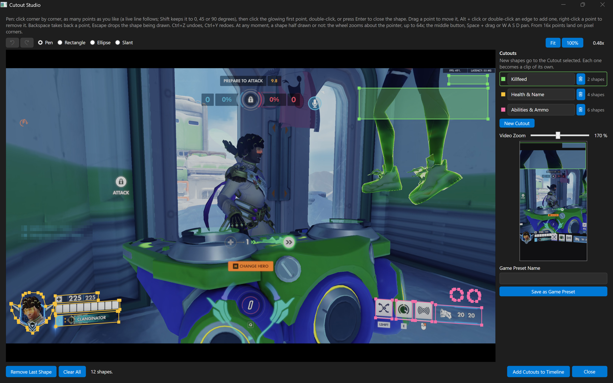
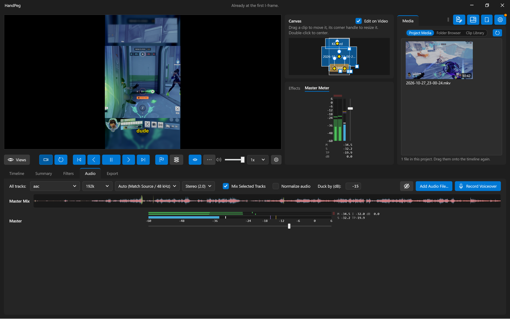
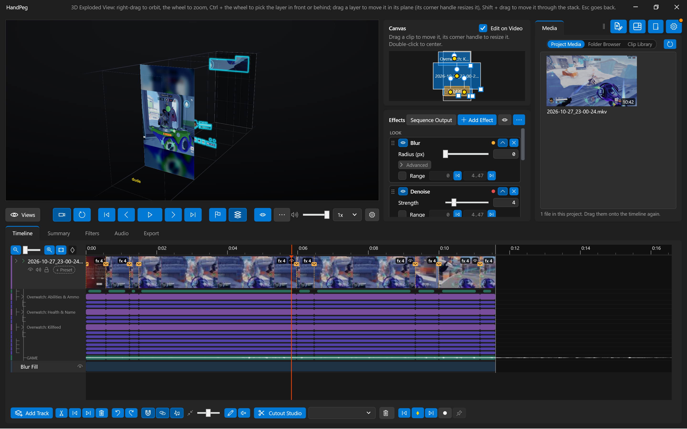

# HandPeg

[](https://github.com/gitclanged/HandPeg/releases/latest)
[](#download)
[](https://dotnet.microsoft.com/download/dotnet/8.0)
[](LICENSE)

HandPeg is a Windows video editor for turning multi-track gameplay recordings and stream VODs into vertical shorts or
clean cuts. Every track is decoded and composited on the graphics card, so long recordings with many cuts play and scrub
without the timeline lagging.









## Main workflows
- **Track Preset Nodes and the Cutout Studio.** Set a Game Preset on a track and every clip on it, or dropped onto it,
  gets that preset's frame, HUD Cutouts and blurred background. Draw your own game's HUD pieces in the Cutout Studio
  (pen, rectangle, ellipse, slant; zoom up to 64x with a pixel grid) and save them as a preset.
- **Multi-track audio.** Each audio stream of a recording gets its own Sub-Lane under its clip. Studio Voice (denoise,
  presence and a broadcast leveller in one card), a De-Esser and a parametric EQ are effect cards; the Master Meter pane
  shows live LUFS and true peak beside a master fader.
- **GPU compositor.** A Direct3D 11 compositor in a process of its own decodes and draws every track and effect, and
  exports frame-exact; a driver fault restarts it without taking the editor down. Layers can tilt in 3D, and the 3D
  Exploded View fans the stack out by depth.
- **Project bundles and OBS recordings.** Save a project and its media as one `.hpb` file (stored, not re-encoded; long
  recordings can be trimmed to the parts in use). Split an OBS side-by-side recording into gameplay and facecam in one
  step.

## Download
From the [latest release](https://github.com/gitclanged/HandPeg/releases/latest):

- `HandPeg-win-Setup.exe`: the installer (Windows 10 or 11, x64, with the .NET 8 Desktop Runtime). It updates itself.
- `HandPeg-5.2.0-win-x64-Portable.zip` (about 6 MB): unzip and run.
- `HandPeg-5.2.0-win-arm64-Portable.zip` (about 6 MB): the same for Windows on ARM.

A portable copy keeps everything it writes in the `portable` folder beside `HandPeg.exe`. On a PC without .NET 8, run
`Download Portable .NET (No Admin).cmd` once: it puts Microsoft's runtime into the folder, checked against Microsoft's
published hashes, without admin rights. The first start downloads FFmpeg (and, for captions, whisper.cpp), pinned to
builds tested with this version.

## Building from source
```
dotnet build HandPegApp.csproj
powershell -NoProfile -ExecutionPolicy Bypass -File tools\GoldenTests.ps1
```
`tools\README.md` describes the developer tools (golden tests, the A/V sync check, the start-up benchmark).

## License
MIT: see [LICENSE](LICENSE).
