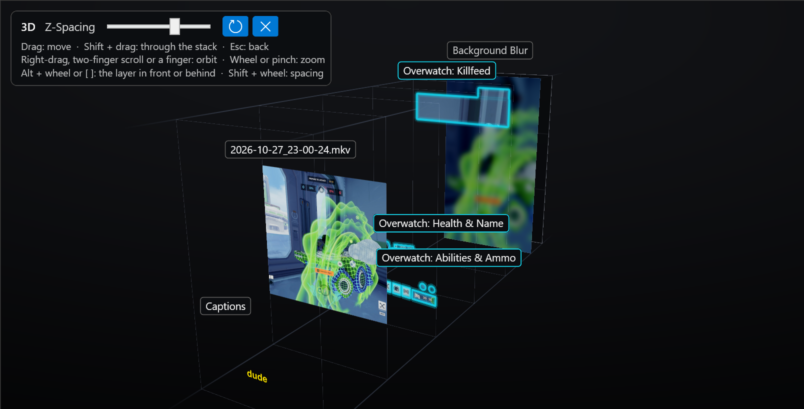

# HandPeg

[](https://github.com/gitclanged/HandPeg/releases/latest)
[](#download)
[](https://dotnet.microsoft.com/download/dotnet/10.0)
[](LICENSE)

HandPeg is a Windows video editor for turning multi-track gameplay recordings and stream VODs into vertical shorts or
clean cuts. Every track is decoded and composited on the graphics card, so long recordings with many cuts play and scrub
without the timeline lagging.




## Main workflows
- **Track Preset Nodes and the Cutout Studio.** Set a Game Preset on a track and every clip on it, or dropped onto it,
  gets that preset's frame, HUD Cutouts and blurred background. Draw your own game's HUD pieces in the Cutout Studio
  (pen, rectangle, ellipse, slant; zoom up to 64x with a pixel grid, pan with a right-drag or the Source Navigator's
  picture of the whole frame) and save them as a preset.
- **Multi-track audio.** Each audio stream of a recording gets its own Sub-Lane under its clip. Studio Voice (denoise,
  presence and a broadcast leveller in one card), a De-Esser and a parametric EQ are effect cards; the Master Meter pane
  shows live LUFS and true peak beside a master fader.
- **GPU compositor.** A Direct3D 11 compositor in a process of its own decodes and draws every track and effect, and
  exports frame-exact; a driver fault restarts it without taking the editor down. Layers can tilt in 3D, and the 3D
  Exploded View fans the stack out by depth (pinch to zoom and two-finger scroll to orbit on a touchpad or touch screen).
- **Project bundles and OBS recordings.** Save a project and its media as one `.hpb` file (stored, not re-encoded; long
  recordings can be trimmed to the parts in use). Split an OBS side-by-side recording into gameplay and facecam in one
  step.

## Download
From the [latest release](https://github.com/gitclanged/HandPeg/releases/latest):

- `HandPeg-win-Setup.exe`: the installer (Windows 10 or 11, x64). It updates itself.
- `HandPeg-win-arm64-Setup.exe`: the native installer for Windows on ARM (Snapdragon PCs). It updates itself from the ARM64
  releases.
- `HandPeg-5.3.1-win-x64-Portable.zip` (about 7 MB): unzip and run `HandPeg.exe`.
- `HandPeg-5.3.1-win-arm64-Portable.zip` (about 7 MB): the same for Windows on ARM.

HandPeg runs on Microsoft's .NET 10 Desktop Runtime, and neither the installers nor the zips need it installed first. On a PC
without it (an older .NET such as .NET 8 is not enough), `HandPeg.exe` asks the first time it starts: download .NET 10 for
HandPeg alone (recommended: no admin rights, kept in `%LOCALAPPDATA%\HandPeg\dotnet` for an installed copy, which the
uninstaller removes, or in `portable\dotnet` for a portable copy), or install it for every program with Microsoft's own installer
(asks for admin rights). Either way it is checked against Microsoft's published SHA-512 hashes, and no script runs (a locked-down
PC that blocks `.cmd` and PowerShell files still starts it). A portable copy keeps everything it writes in the `portable` folder
beside `HandPeg.exe`. The first start then downloads FFmpeg (and, for captions, whisper.cpp), pinned to builds tested with this
version.

## Building from source
```
dotnet build HandPegApp.csproj
powershell -NoProfile -ExecutionPolicy Bypass -File tools\GoldenTests.ps1
```
Building needs the .NET 10 SDK. `tools\README.md` describes the developer tools (golden tests, the A/V sync check, the start-up
benchmark). The `HandPeg.exe` of the installers and the portable zips is a native program (`tools\PortableBootstrap`, NativeAOT):
publishing it needs Visual Studio's C++ build tools, with the ARM64 and x64 compilers.

## License
MIT: see [LICENSE](LICENSE).
